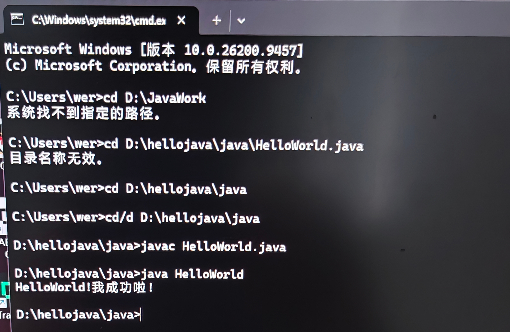
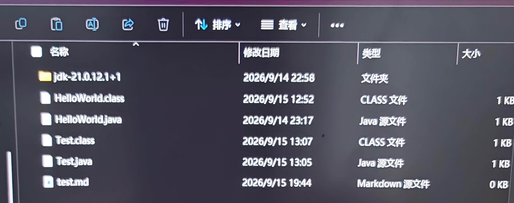

## task1
#### 1.JDK:java开发工具包   JRE:运行环境   JVM：负责运行的虚拟计算机
#### JDK JRE JVM 的关系
##### 我的理解：笼统来讲，JDK>JRE>JVM，JVM又叫JAVA虚拟机，运行.class文件，好处是不同的JVM可以运行同一份文件，但是只负责运行这一步，不能独立开发程序，我感觉类似于汽车的发动机，没有轮子和车身，而JRE，则为java程序运行提供了环境，相当于完整的车，JDK则多了开发工具，类似于造车修车的工具，所以JDK能做到开发程序。
#### 2.原因：JDK负责把我们写的代码编译成字节码（.class文件），JRE提供环境和类库（前人写好的代码，类似于System List等），JVM负责加载并执行.class文件
#### 3.JDK21
#### 4.C:\Users\wer>java -version
openjdk version "21.0.12.1" 2026-08-18 LTS
OpenJDK Runtime Environment Temurin-21.0.12.1+1 (build 21.0.12.1+1-LTS)
OpenJDK 64-Bit Server VM Temurin-21.0.12.1+1 (build 21.0.12.1+1-LTS, mixed mode, sharing)
#### C:\Users\wer>javac -version
javac 21.0.12.1

## task2
#### 1.JAVA_HOME：告诉操作系统的和其他软件JDK安装在哪里，以便用其他开发工具时，工具能找到JDK。
####  Path:操作系统用path找java和javac的命令，然后让这两个工作
#### 2.操作系统在执行命令时，在PATH中找到JDK的bin目录，然后搜索到java(c).exe，开始执行，如果不配置，就会显示不是内部或外部命令。
#### 3和4.HelloWorld.java(源文件)：给人看的，程序逻辑，
#### HelloWord.class(字节码文件)：二进制文件，包含JVM能识别的和执行的字节码，给机器看的，可跨平台
#### javac作用:java编译器，检查并翻译源文件
#### java作用：java的运行工具，负责启动JVM，加载字节码文件并执行main方法，在屏幕上输出结果
## task3
#### 1.理解基本结构：
#### 第一行：包声明，说明把代码文件放在com.Example里
#### 第二行：提前告诉系统要借用Print工具
#### 类声明:public class HelloWorld（主类）：把程序装进叫HelloWorld的盒子里（包装成类）。class test（辅助类）:程序具体要做的活
#### 方法声明:public static void main:程序入口，程序执行的起点，~~test:定义系统具体要执行的内容。
#### 2.是什么：包类似文件夹，里面有很多java类文件
#### 为什么：很多Java文件会出现重名的情况，package就是用来分类见文件夹的，便于找到目标文件。
#### 3.import作用：告诉程序要借个工具，避免每次使用时都要写出工具全名。
#### 4.JVM规定启动程序只能从main开始，JVM只会在main后开始工作。
#### 5.
## task4 运行结果见3.5
#### 项目结构说明：
#### src文件夹：根目录，存放所有文件
#### com.Example:主包，用于存放主程序代码，包含入口类
#### com.Example.tool：子包，存放工具类
#### HelloWorld.java：主类，包含main方法，是程序的入口，通过引入工具类来完成任务
#### Print.java：工具类，包含具体的工作内容，封装打印动作，被其他类（比如主类）调用，提高工作效率。
#### Print.java代码：
#### 运行结果：
##### 备注：遇到过的问题：命令行切换路径失败，把文件夹当成文件，未加/d参数，导致无法切换，不了解path与java_home,然后理解了home是给其他软件指路的，path是让系统找到编译器和启动器，刚开始把主类和工具类建在一个文件夹里，也没意识到少写了import（idea太智能了），通过重构理清了各个文件之间的关系，明白了为什么工具类和主类要分开放置，还有一个有意思的，因为之前我用过idea（看教程的时候，当时啥都不知道，就只建了一个文件用来写代码），但是后面做题的时候发现要重新建，这时候问题就来了，虽然文件删了，但是idea还在用旧的历史配置去找Main类（我之前建的那个），所以报错了，然后问ai把运行配置改了。
##### 传参的时候学会了给main传参，明白了String[] args只是一个空筐，必须添加实参才行，最后，理解了print为什么不能自己运行（只是被调用的工具）
##### 一点感受：ai真好用  命令行让我明白代码运行的底层原理，虽然只会报错没有提示（没事，有ai）。    idea一键编译运行减少工作量，还有自动补齐和精准报错提示（目前感觉最有用）