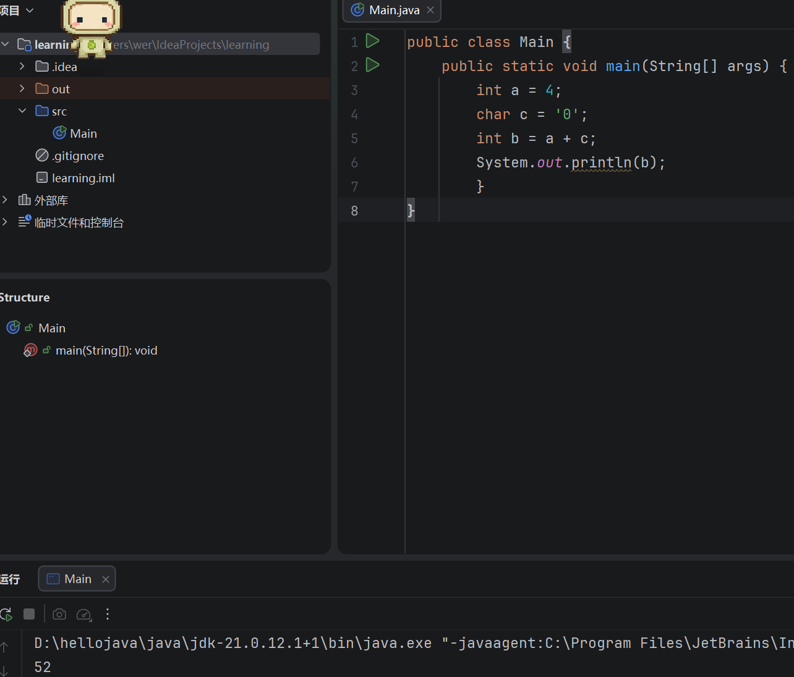
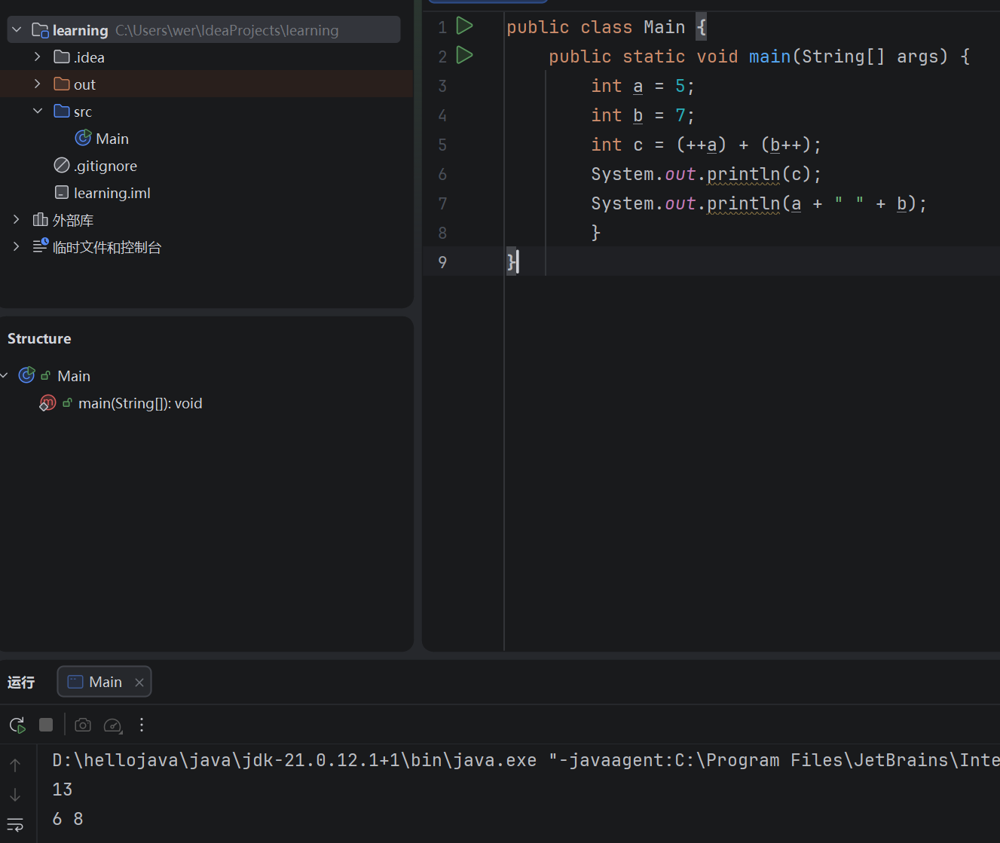
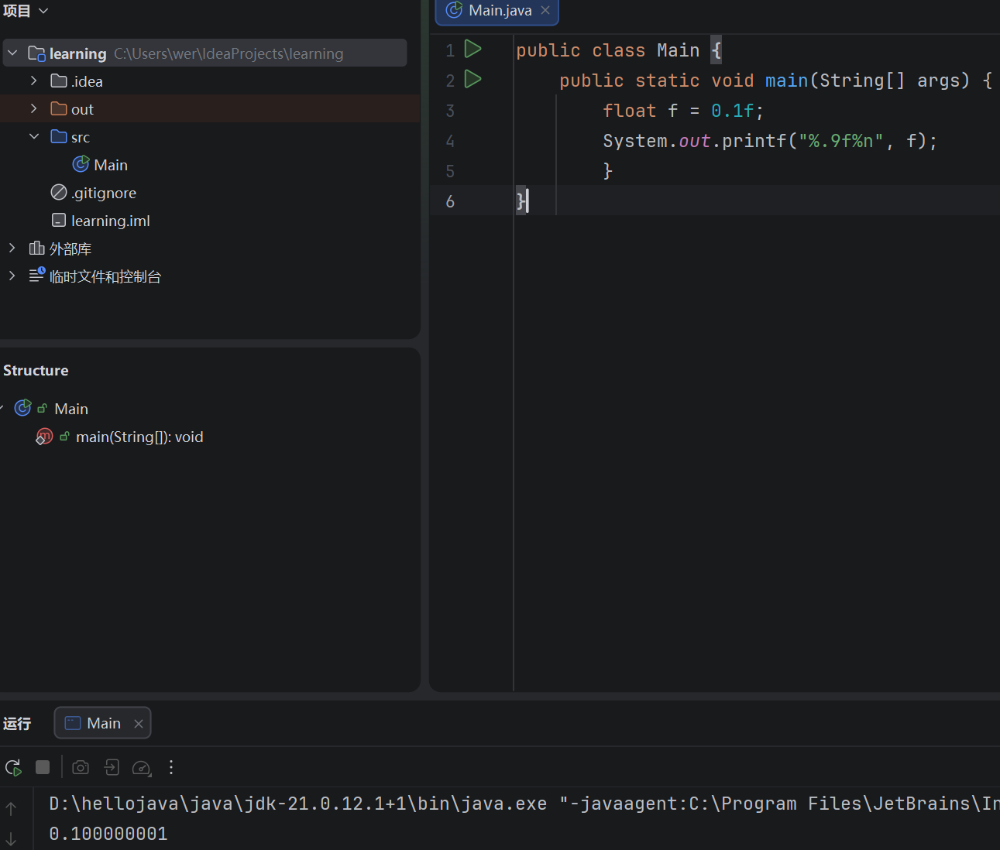
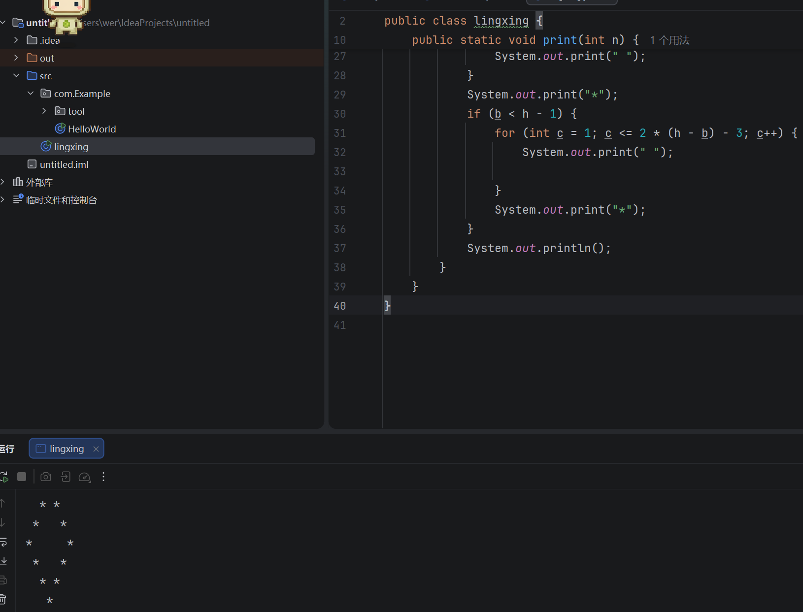
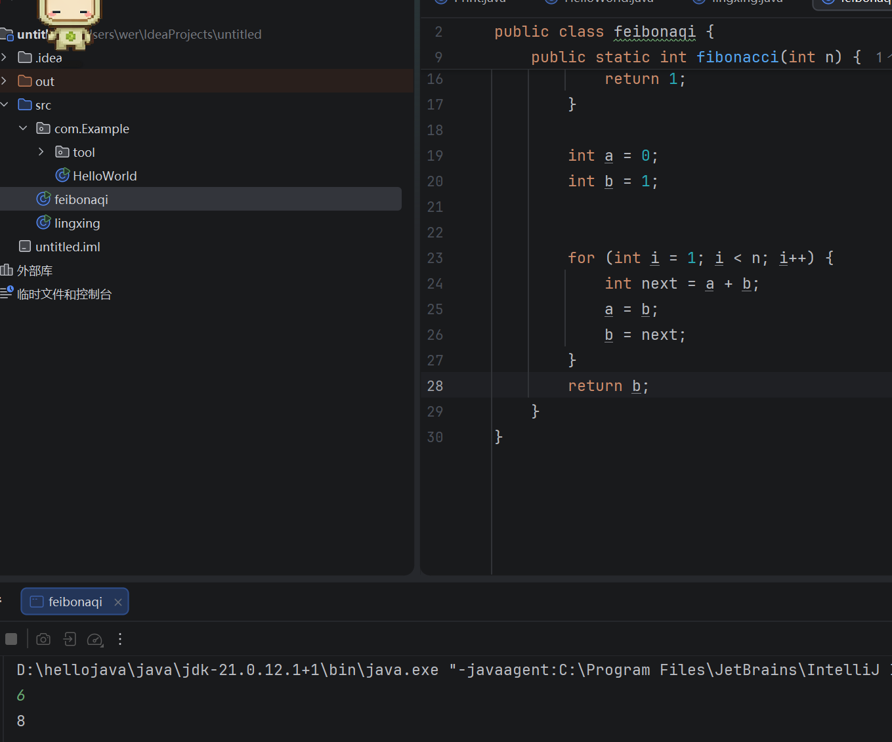
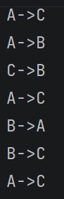
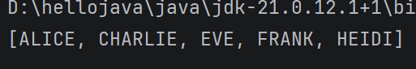

## 数据类型、控制流与异常处理
#### 一.数据类型与运算基础
##### 1.
- 整型：byte short int long
- 浮点型：float double
- 字符型：char
- 布尔型：boolean
##### 2.
- byte:1字节，范围-128~127
- short：2字节，范围-32768~32767
- int：4字节，范围-2^31~2^31-1
- long：8字节，范围-2^63~2^63-1
##### 3.Java 的基本数据类型变量直接保存具体的数值，赋值给另一个变量时复制的是值，因此修改其中一个变量不会影响另一个变量；引用数据类型变量保存的是对象的引用。两个引用变量可以指向同一个对象，例如同一个数组。这时通过其中一个变量修改数组元素，另一个变量访问该数组时也能看到修改后的内容。
##### 4.隐式类型转换
##### 5.b = 52  因为字符'0'对应的Unicode数值为48，参与整数加法时按该数值计算，所以 4 + 48 = 52
运行结果：



##### 6.
```java
int a = 5;
int b = 7;
int c = (++a) + (b++);
```
++a 先让 a 增加到 6，再参与运算
b++ 先使用 b 原来的值 7，再让 b 增加到 8
因此 c 的值为 13，a 最终为 6，b 最终为 8
预期结果：
13
6 8
运行结果：



##### 7.Java的int使用32位二进制补码表示，当两个正整数相加超过int最大值时，会发生整数溢出。舍弃高位让第一位变成1，会变成负数
例如2147483647+1的结果是-2147483648
011111111~~  ->  100000000~~~
##### 8.float 采用有限位数的二进制浮点表示。
有些十进制小数，例如0.1，无法用有限位二进制精确表示。因此计算机只能保存近似值，产生舍入误差。当这些近似值参与运算时，误差可能影响计算结果。
运行结果：



#### 二.控制流和基础算法
#### 1.
代码：[weiguang.java](../代码/src/weiguang.java)。

思路：能被4整除但不能被100整除，或者能被400整除，就是闰年。

- 闰年判断需要结合多个条件进行逻辑运算，因此适合使用 if-else。而菜单选择通常是根据某个变量的固定取值执行不同操作，因此使用switch-case更加清晰、方便。
- 在根据固定取值进行分支选择时,switch-case和if-else可以实现相同的功能，而switch-case往往更加简洁，因此可以在一定程度上将它理解为语法糖。
但是两者并不完全相同。传统 switch-case 如果没有break，就会继续执行后面的分支代码，可能产生意料之外的结果；而if-else在前面的条件成立后，不会进入后面的分支。
#### 2.
代码：[Main2task2t2.java](../代码/src/com/Example/Main2task2t2.java)。

思路：先打印上半部分，再打印下半部分，每行先输出前面的空格，再输出两边的星号和中间的空格。最上面和最下面只有一个星号。

运行结果：



##### 3.
代码：[迭代版feibonaqi.java](../代码/src/feibonaqi.java)、[递归版feibonaqiRecursive.java](../代码/src/feibonaqiRecursive.java)。

运行结果：



区别：迭代主要通过 for、while 等循环结构重复执行代码，并不断更新变量来完成运算；
递归则是一个方法在执行过程中调用自己，将一个复杂问题拆解为规模更小的同类问题，再利用返回值完成计算。
为什么：迭代可减少方法调用，在斐波那契数列中，使用循环只需不断更新前两个数字，直接递归会重复计算相同的数列项，导致运行效率下降
能不能：能。可以把循环改写成递归，但是会增加方法调用和栈空间的开销，递归层数太深时可能发生StackOverflowError。
递归版的思路：先判断n是不是0或1，其他情况把第n项拆成前两项相加。迭代版用两个变量保存前两项，不断更新。这里返回int，n超过46时会溢出，递归版也不适合输入太大的n。

递归版运行结果：输入10，输出55；输入0，输出0；输入1，输出1。

##### 选做：汉诺塔
代码：[hanoi.java](../代码/src/com/hanoi.java)。

思路：先把A上面的n-1个盘子借助C移到B，再把最下面的盘子从A移到C，最后把B上的n-1个盘子借助A移到C。只剩一个盘子时，直接从起点移到终点。

运行结果：



#### 三.异常处理与程序健壮性
##### 概念
1.Error：JVM 或运行环境出现的严重问题，通常不是程序通过捕获异常能够解决的
2.Exception：程序运行过程中可以预料并处理的问题

##### checked exception和unchecked exception
checked exception：编译时就要求处理，可以用try-catch捕获，或者用throws交给调用它的地方处理。比如读取的文件不存在，可能发生FileNotFoundException。

unchecked exception：编译时不强制要求捕获，常见的有空指针、数组越界、错误的类型转换等，通常要检查输入或修改程序逻辑。RuntimeException及其子类和Error及其子类都属于这一类。

面对Exception，要根据情况处理并给出提示；面对Error，一般不能指望简单catch后就恢复正常，要检查运行环境或程序本身的问题。

##### 读取文件并计算平均值
代码：[Main1.java](../代码/src/com/Example/Main1.java)、[EmptyFileException.java](../代码/src/com/Example/EmptyFileException.java)、[Print.java](../代码/src/com/Example/tool/Print.java)。

思路：用Scanner读取当前目录的data.txt，sum记录总和，count记录读到了几个整数。遇到不能转成整数的内容就提示并跳过，读完后用总和除以个数。没有读到整数时抛出EmptyFileException。try-with-resources会在结束时关闭Scanner和文件，不需要另外手动关闭。

[示例data.txt](../代码/data.txt)和src放在同一目录，运行这个程序时把“代码”文件夹作为工作目录。

运行结果：
- data.txt内容是1、2、3，每行一个数：输出“平均数是2.0”。
- 文件不存在：输出“文件不存在”。
- 文件为空：输出“文件为空”。
- 文件中依次有1、abc、3：提示“存在非整数abc”，跳过abc后输出“平均数是2.0”。

#### 四.Stream流
##### 1.直接打印limit会怎样？
打印的是流对象的信息，不是里面的字符串。limit(4)只是得到一个最多保留前4个元素的新流，还没有要求把元素逐个打印出来。如果要看元素，可以用forEach打印，或者先收集到List里再打印。

##### 2.筛选及格学生
代码：[Main2task4.java](../代码/src/Main2task4.java)、[Student.java](../代码/src/Student.java)。

思路：filter留下分数大于等于60的学生，map取出姓名并转成大写，sorted按姓名排序，最后toList收集起来再打印。

运行结果：



#### 遇到的问题
读取文件时，代码里的data1.txt和题目要求的data.txt不一致，需要统一文件名。相对路径是从运行时的工作目录开始查找，不是从Main1.java所在的目录查找，所以运行目录也要确认。
