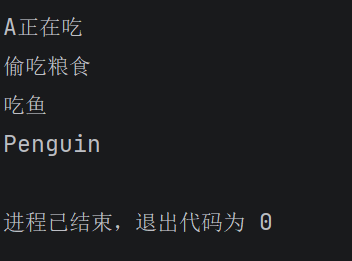
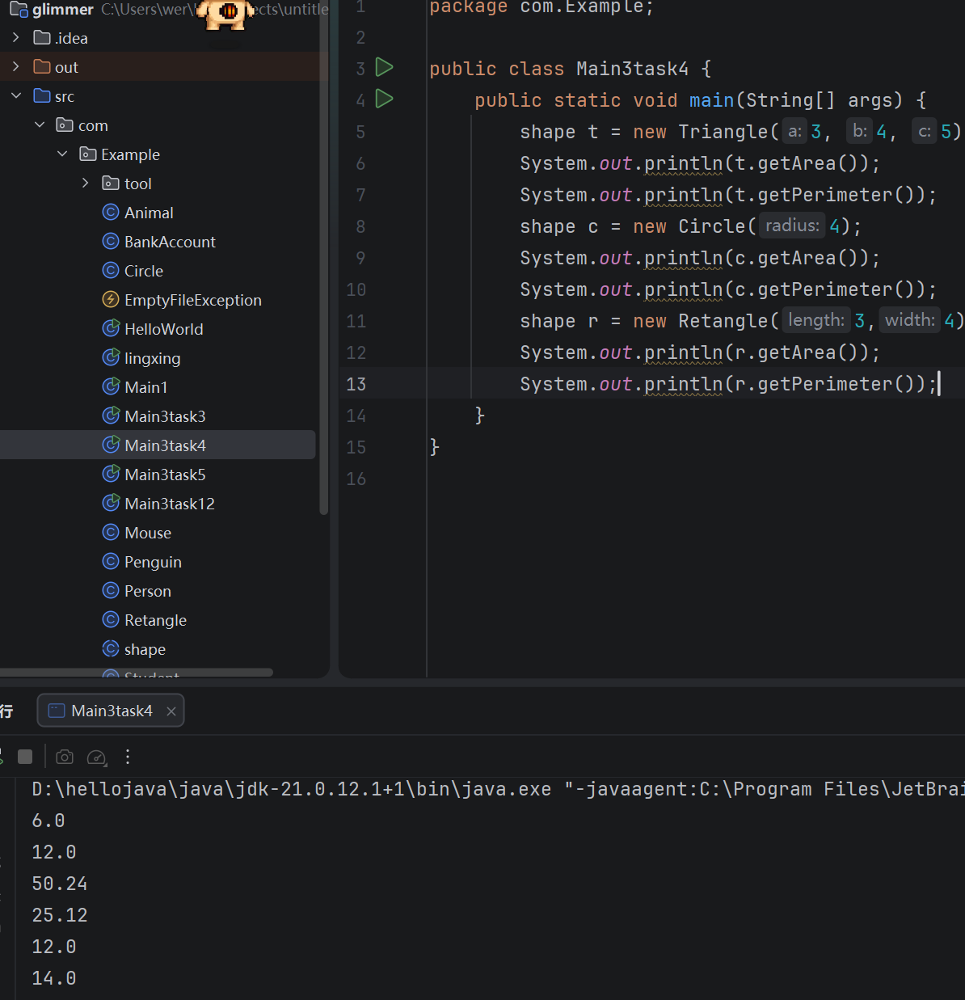
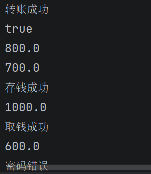

## 面向对象、封装继承与多态

## task1 类、对象与构造方法
#### 1.构造方法和复制对象：见代码。
#### 2.this的作用
##### 用到了，例如this.name = name，左边是当前对象的属性，右边是传进来的参数。名字相同时，用this区分，我的理解就是“当前这个对象”。
#### 3.main中创建对象并赋值：见代码。
#### 4.类和对象的关系
##### 我的理解：类像表格模板，规定有哪些信息；对象就是按模板填出来的具体一份。Person是类，分别创建的小明和小红就是两个对象，属性相同，具体的值可以不同。
##### 代码：[Person、Main3task12](https://github.com/yangrx8/java-work/tree/main/03-%E9%9D%A2%E5%90%91%E5%AF%B9%E8%B1%A1%E3%80%81%E5%B0%81%E8%A3%85%E7%BB%A7%E6%89%BF%E4%B8%8E%E5%A4%9A%E6%80%81/%E4%BB%A3%E7%A0%81/src/com/Example)。

## task2 访问修饰符、实例成员与静态成员
#### 1.给字段和方法添加访问修饰符：见代码。
#### 2和3.访问范围和四种权限

| 修饰符   | 当前类内部 | 同包其他类 | 不同包子类 | 不同包普通类 |
| --- | --- | --- | --- | --- |
| public  | 可以       | 可以      | 可以       | 可以        |
| private | 可以       | 不可以    | 不可以      | 不可以      |
| protected | 可以      | 可以     | 有条件地可以 | 不可以     |
| 默认权限 | 可以        | 可以     | 不可以      | 不可以      |

##### 默认权限就是不写访问修饰符。protected在不同包中只能通过继承按规则访问，不能随意通过一个父类对象访问。上表的前提是类本身也能被访问。
#### 4.增加静态变量：见代码。
#### 5.静态方法和实例方法
##### 静态方法属于类，不依赖某个具体对象，所以可以直接通过类名调用。比如我写的Person.getcount()。
##### 实例方法属于对象，可能要用这个对象的属性，所以通常要先创建对象，再调用。例如先创建对象p，再调用p.toString()。
##### 代码：[Person、Main3task12](https://github.com/yangrx8/java-work/tree/main/03-%E9%9D%A2%E5%90%91%E5%AF%B9%E8%B1%A1%E3%80%81%E5%B0%81%E8%A3%85%E7%BB%A7%E6%89%BF%E4%B8%8E%E5%A4%9A%E6%80%81/%E4%BB%A3%E7%A0%81/src/com/Example)。

## task3 继承与代码复用
#### 1—3.Penguin、Mouse、super和方法重写：见代码。
#### 4.为什么Java不支持类的多继承？
##### 因为多个父类可能提供同名方法，子类继承后就会有冲突。比如菱形继承中，两个父类都重写了同一个上层父类的方法，下面的子类就需要处理到底使用哪一个的问题。Java选择让类只直接继承一个父类，减少这种复杂情况，但一个类可以实现多个接口。
##### 代码：[Animal、Penguin、Mouse、Main3task3](https://github.com/yangrx8/java-work/tree/main/03-%E9%9D%A2%E5%90%91%E5%AF%B9%E8%B1%A1%E3%80%81%E5%B0%81%E8%A3%85%E7%BB%A7%E6%89%BF%E4%B8%8E%E5%A4%9A%E6%80%81/%E4%BB%A3%E7%A0%81/src/com/Example)。
##### 运行结果：

## task4 多态与抽象设计
#### 圆形、三角形、矩形的面积和周长：见代码。
##### 代码：[shape、Circle、Triangle、Retangle、Main3task4](https://github.com/yangrx8/java-work/tree/main/03-%E9%9D%A2%E5%90%91%E5%AF%B9%E8%B1%A1%E3%80%81%E5%B0%81%E8%A3%85%E7%BB%A7%E6%89%BF%E4%B8%8E%E5%A4%9A%E6%80%81/%E4%BB%A3%E7%A0%81/src/com/Example)。
##### 运行结果：

## task5 封装与接口设计
#### 1.public、private等关键字在封装中的作用
##### private把属性和内部方法保护起来，其他类不能直接访问；public给外部提供需要使用的方法。比如余额设为private，外面通过存款、取款等方法操作，方法里再检查金额和密码，不能随便直接改余额。
#### 2.BankAccount：见代码。
##### 代码：[BankAccount、Main3task5](https://github.com/yangrx8/java-work/tree/main/03-%E9%9D%A2%E5%90%91%E5%AF%B9%E8%B1%A1%E3%80%81%E5%B0%81%E8%A3%85%E7%BB%A7%E6%89%BF%E4%B8%8E%E5%A4%9A%E6%80%81/%E4%BB%A3%E7%A0%81/src/com/Example)。

##### 运行结果（部分输出）：

