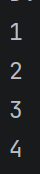
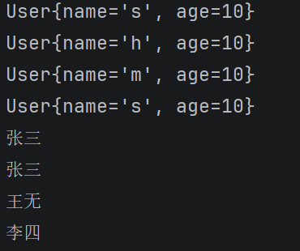
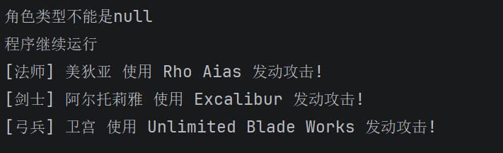

## 集合、泛型与设计模式

## task1 集合与遍历
#### Q1.集合和数组
##### 我的理解：集合和数组都能放一组数据。数组创建后长度固定，集合可以根据需要添加和删除元素，操作起来更方便。
数组可以直接保存基本类型，也可以保存对象；集合保存对象，比如整数要用Integer。集合里具体怎么存、能不能重复、有没有顺序，要看使用的类型。

##### 接口和实现类的理解：
接口规定有哪些操作，实现类把这些操作具体写出来。比如List是接口，ArrayList是它的实现类，所以创建列表时可以写 `List<Integer> list = new ArrayList<>();`。

- Collection：把List、Set、Queue这些接口的共同操作放在一起，比如添加、删除和查看元素个数。
- List：元素有先后顺序，可以重复，可以按下标取出。
- ArrayList：List的一种实现，按下标取元素比较方便，我在遍历题里用的就是它。
- LinkedList：也是List的一种实现，还能用来做队列，处理从头尾添加或取出元素的情况。
- Set：用来保存不重复的元素。
- HashSet：重复的元素只保留一份，但打印顺序不一定和添加顺序相同。
- LinkedHashSet：同样不能重复，但可以保留添加时的先后顺序。
- TreeSet：元素不重复，还能按大小或指定的规则排序。
- Queue：用来排队处理数据，常见的是先放进去的先取出来，也有按优先级取出的队列。
- Map：保存键和值，通过键找到对应的值，比如根据id找用户。键不能重复，值可以重复，它不属于Collection。
- HashMap：Map的一种实现，我在仓库题里用它保存id和数据，不保证按添加顺序打印。
- LinkedHashMap：默认可以按添加键的先后顺序遍历。
- TreeMap：按键的大小或指定规则排序。

#### Q2.增强for循环
##### 代码：[Main4task1.java](代码/src/com/Main4task1.java)
##### 运行结果（部分输出）：

#### Q3.匿名内部类、函数式接口和lambda
##### 1.匿名内部类：不单独给类起名字，创建对象的时候，直接把需要实现的方法写出来。比如题目里创建Consumer对象时，就写了accept方法的实现。
##### 2.函数式接口：只有一个抽象方法的接口，Consumer就是一个例子。默认方法和静态方法不算在这一个抽象方法里面。
##### 3.lambda：可以用来简化函数式接口的实现，基本写法是“(参数) -> 方法体”。
比如 `n -> System.out.println(n)`，n是接收到的参数，箭头后面是要做的事。

- 没有参数时，括号不能省，写成 `() ->`。
- 只有一个参数，并且不写参数类型时，可以省略括号，比如 `n ->`。
- 多个参数要加括号，比如 `(a, b) ->`。
- 方法体有多条语句时，要用大括号包起来；如果还需要返回值，就在里面写return。

##### 代码：[Main4task2.java](代码/src/com/Main4task2.java)
##### 运行结果：和Q2一样，每次遍历输出1、2、3、4，上面的截图保留了部分输出。

## task2 泛型
#### Q4.仓库
##### 代码：
- [Repository.java](代码/src/com/Repository.java)
- [Myrepository.java](代码/src/com/Myrepository.java)
- [User.java](代码/src/com/User.java)
- [Main4task3.java](代码/src/com/Main4task3.java)

##### 运行结果（部分输出）：

## task3 面向对象设计模式
#### Q5.角色创建系统
##### 代码：
- [Character.java](代码/src/Character.java)
- [CharacterType.java](代码/src/CharacterType.java)
- [Saber.java](代码/src/Saber.java)
- [Archer.java](代码/src/Archer.java)
- [Caster.java](代码/src/Caster.java)
- [characterFactory.java](代码/src/characterFactory.java)
- [Main4task4.java](代码/src/Main4task4.java)

##### 运行结果：

#### 做题过程和一点感受
这题先用增强for遍历list，又写了普通for作对比，感觉增强for确实方便。后面写lambda时，先把它赋给Consumer变量再传给forEach，又试了直接把lambda写进forEach里，刚开始理解有点困难，后面多找了几个题练了一下才搞清楚哪些可以省。我在代码里记的是“感觉像是创建对象又重写了方法”，这样和匿名内部类联系起来就好理解一些。

泛型这部分写了Repository接口和Myrepository类，用HashMap保存数据，id从0开始增加。然后分别存了User、String、Integer，试了按id查找和打印全部内容，这样才把<T>具体用起来。刚开始没理解题目，以为把数据全存在一个hashmap里面，给自己搞懵了，后面才想清楚创建三个仓库就是又三个hashmap。

最后写角色工厂，把创建角色的判断放进工厂里，再在main里创建角色、调用attack。试了传入null，捕获异常后打印“程序继续运行”，再创建三个角色。最主要的就是写characterFactory比较麻烦，要判断是否是null，还要创建对象，但是感觉理解起来没有前面的难，又复习了一下异常处理。