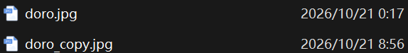
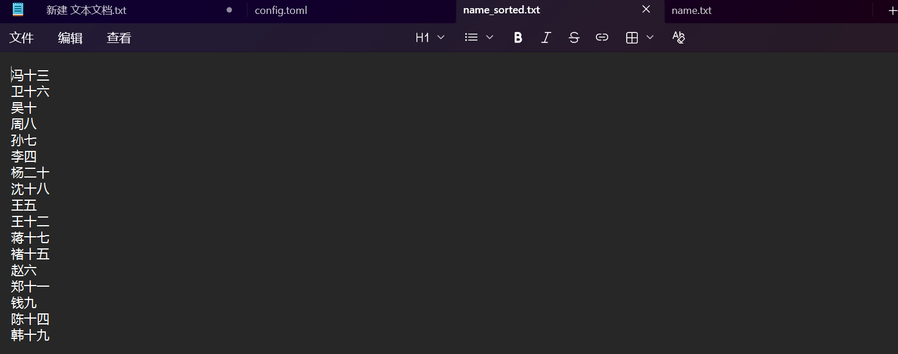
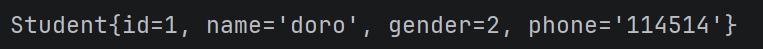
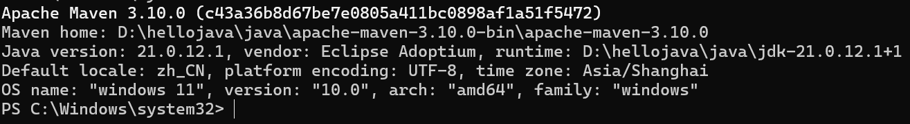
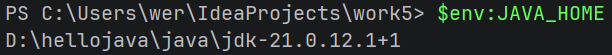
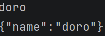
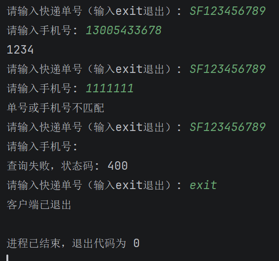

## IO流与项目挑战

## task1 字节流和字符流
#### Q1.复制图片
##### 代码：[Main5task1.java](../代码/task1-task2/src/com/Main5task1.java)
思路：用字节流读取doro.jpg，每次用1024字节的数组接收，再把这次实际读到的内容写入doro_copy.jpg。read返回-1时结束。try-with-resources会关闭流，按声明的相反顺序，先关输出流，再关输入流。

##### 运行结果：



#### Q2.姓名排序
##### 代码：[Main5task2.java](../代码/task1-task2/src/com/Main5task2.java)
思路：用UTF-8读取name.txt，每次读取一行，去掉首尾空格和空行，再放进List里按自然顺序排序，最后一行一个名字写入name_sorted.txt。newLine会使用当前系统的换行方式，不用自己判断换行符。

##### 运行结果：



## task2 序列化和反序列化
#### Q3.保存和读取Student对象
##### 代码：[Main5task3.java](../代码/task1-task2/src/com/Main5task3.java)、[Student.java](../代码/task1-task2/src/com/Student.java)
我的理解：序列化就是把对象保存成可以写入文件的数据，反序列化再把这些数据读回对象。Student实现Serializable接口，先用ObjectOutputStream写入student.dat，关闭输出流后再用ObjectInputStream读取，最后打印对象的信息。

这三道题运行时，以 [task1-task2文件夹](../代码/task1-task2) 为工作目录，图片和文本也放在这里。

##### 运行结果：



## task3 Maven
#### 1.是什么，为什么要用？
##### 我的理解：Maven是管理Java项目的工具，可以帮忙下载依赖、编译和打包，不用自己一个个找jar包再添加进项目。
JAR是把类和其他资源打包到一起的文件。项目依赖的库经常以JAR提供，自己的项目也可以打成JAR。Maven可以管理这些依赖和它们的版本，但程序最后还是由JDK编译、运行。

#### 2.安装和IDEA配置
先装Maven、配环境变量，再到IDEA里设置Maven、settings.xml和本地仓库。JAVA_HOME填JDK根目录，Path里加Maven的bin目录。

##### Maven版本：



##### JAVA_HOME：



#### 3.仓库
- 本地仓库：保存在自己电脑上的依赖、插件和自己install进去的项目产物。我设置的位置是 `D:/hellojava/maven-repository`，在settings.xml的localRepository里配置。
- 远程仓库：本地没有需要的依赖时，可以从远程仓库下载。
- 中央仓库：常用的公共仓库，很多开源库会发布在这里。
- 私服：自己或团队维护的仓库，可以保存内部项目，也可以代理其他仓库。

#### 4.项目和pom.xml
项目的配置在 [pom.xml](../代码/task4/pom.xml)。groupId是cn.weiguang，artifactId是work5，version是1.0-SNAPSHOT。我的理解是，这几个参数一起用来区分一个项目和它的版本。

```text
task4/
├─ pom.xml                 项目配置
├─ src/main/java/          正式代码
├─ src/main/resources/     正式配置和资源
├─ src/test/java/          测试代码
├─ src/test/resources/     测试配置和资源
└─ target/                构建时生成的文件
```

上面是常用的目录，没用到的先没建。pom.xml用来配置项目，这次用了Java 21和Fastjson2，版本写在里面，打包出来是jar文件。

依赖写在dependencies里，填好名称和版本，再刷新Maven。先试了Map转JSON，后面又拿QueryRequest试了对象和JSON互相转换。



#### 5.常用命令

| 命令 | 我的理解 |
| --- | --- |
| `mvn compile` | 编译正式代码，生成的类在target/classes里 |
| `mvn package` | 构建并打包项目，会先完成需要的编译等步骤 |
| `mvn clean` | 清理target等构建输出 |
| `mvn clean package` | 先清理，再重新构建和打包 |
| `mvn install` | 完成构建，并把项目产物安装进本地仓库 |

这些命令也可以在IDEA的Maven面板里点着用，还用jar tf看了打包出来的文件，里面能找到编译后的类。

#### 6.一点理解
Maven这部分主要借助AI理解和配置，再自己敲命令，看生成的文件放在哪里。现在大概分清了：源码在项目里，编译、打包的结果在target里，依赖放在本地仓库。Maven负责管理和构建，最后运行程序还是用Java。

## task4 快递取件码查询系统
#### 1.代码
- [Server.java](../代码/task4/src/main/java/cn/weiguang/Server.java)
- [Client.java](../代码/task4/src/main/java/cn/weiguang/Client.java)
- [QueryRequest.java](../代码/task4/src/main/java/cn/weiguang/QueryRequest.java)
- [QueryResponse.java](../代码/task4/src/main/java/cn/weiguang/QueryResponse.java)

在task4项目中编译后，先运行Server，再运行Client。两边通过HTTP和JSON通信，客户端输入单号和手机号，服务端查询对应的取件码。

#### 2.运行结果



#### 3.感悟和理解
这次比较有用的是把对象、JSON字符串和字节数组这几个步骤连起来了。response里的内容要先填好，再转JSON，最后按UTF-8转成字节发送。之前先生成JSON再改response，以为字符串也会跟着变，实际不会，它们已经是分开的内容了。

写HTTP响应时，也慢慢分清了响应头和响应体。状态码、Content-Type、Content-Length是在说明这次响应，真正的内容还要通过输出流写出去。length填的是字节数，不能直接拿字符串长度代替，尤其里面有中文的时候。之前错误分支只发送了状态码和长度，没有写响应体，Client自然收不到完整提示。

try-with-resources也不是把代码套进去就行。中间加了内层try以后，catch接错了位置，前面的参数检查异常就捕获不到了。后面才分清，内层try负责管理输出流，外层try和catch处理整个请求。这样看大括号和异常范围，比单独记try-catch的写法清楚一些。

最后Client已经能正常显示了，又检查原始JSON，才发现pick_code是null时被省略了。Client里取出来同样是null，所以只看客户端结果还发现不了这个区别。加上JSONWriter.Feature.WriteNulls以后，响应里才保留了题目要求的pick_code:null。感觉这一步最有收获，能查到结果不代表返回格式就对了，还得看状态码、响应头和实际发出去的JSON。
