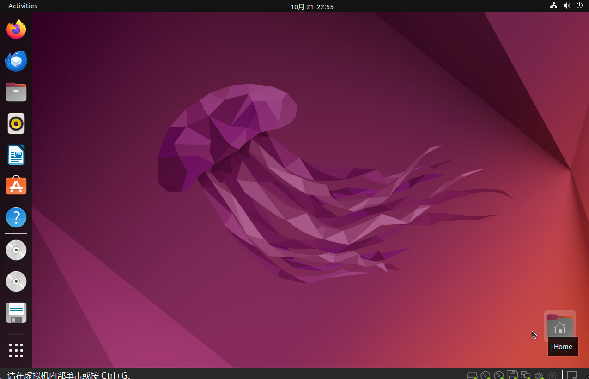
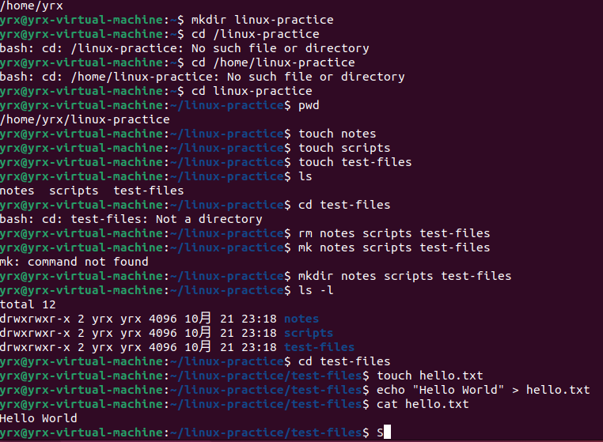
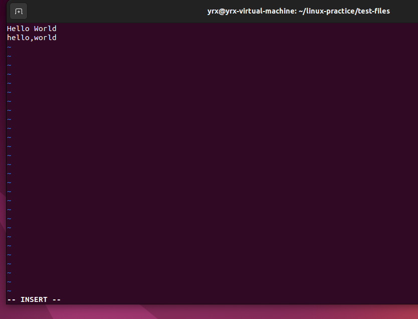
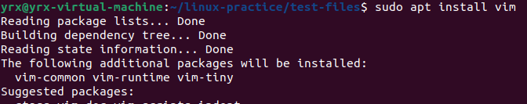

## Linux的使用

## task1 安装与Linux发行版
#### 1.安装结果
之前用过WSL，这次在VMware里安装Ubuntu，打开了桌面。



#### 2.Linux发行版的理解
Linux内核是系统的核心，负责管理CPU、内存、硬件、文件和网络。发行版是在内核的基础上，再加上常用工具、包管理器和其他软件，组成可以安装使用的系统。

我的理解：内核负责最基础的工作，发行版把平时要用的东西也配好了。包管理器有点像应用商店，可以帮忙安装、更新和卸载软件。图形界面可以有，服务器上则比较常用命令行。

- Ubuntu：基于Debian，教程比较多，安装软件可以用apt，这次装的是Ubuntu。
- Debian：比较重视稳定性，也使用apt。
- Fedora：更新比较积极，常用dnf管理软件。
- Arch Linux：很多东西需要自己配置，使用pacman。

它们都用Linux内核，主要是自带的软件、管理软件的方式和更新方式不同。

#### 3.三种网络连接方式
- NAT：虚拟机通过宿主机转发访问外网。我的理解是先把请求交给宿主机，再帮忙发出去，外面的设备要主动访问虚拟机时，通常还需要配置端口转发。
- 桥接：虚拟机像局域网里的另一台电脑，有自己的局域网IP，可以和同一个网络中的其他设备通信。
- 仅主机：主要让宿主机和同一个虚拟网络里的虚拟机通信，默认不能直接访问外网，适合只在本机内部练习。

之前配置WSL代理时用过镜像模式，和这里的仅主机模式不是一回事。

## task2 Linux的目录和基本命令
#### 1.目录结构
Linux没有C盘、D盘这样的盘符，所有目录都从根目录 `/` 开始。

- `/`：根目录。
- `/bin`：常用的基础命令，有些系统会把它链接到 `/usr/bin`。
- `/etc`：系统和软件的配置文件。
- `/home`：普通用户的家目录，这次自己的目录是 `/home/yrx`。
- `/root`：root用户的家目录，和 `/` 不是一个目录。
- `/usr`：很多软件、工具和库放在这里。
- `/var`：经常变化的数据，比如日志和缓存。
- `/tmp`：临时文件。
- `/dev`：设备相关的文件。
- `/proc`：可以查看进程和系统运行信息。

#### 2.创建目录，写入和查看文件
先在home里创建linux-practice，再进入里面创建notes、scripts和test-files。

```text
~/linux-practice/
├─ notes/
├─ scripts/
└─ test-files/
   └─ hello.txt
```

操作时先用mkdir创建目录，再用touch创建hello.txt，echo写入文字，cat查看内容。



截图中写入的是 `Hello World`。题目要求的是不带空格的 `HelloWorld`，对应命令是：

```bash
echo "HelloWorld" > hello.txt
cat hello.txt
```

#### 3.常用命令速查
命令比较多，先把用到的整理下来，后面还要多用才能记住。

| 命令 | 作用 |
| --- | --- |
| `pwd` | 查看当前所在目录 |
| `ls`、`ls -l` | 查看目录内容，-l能看权限等详细信息 |
| `ls -R` | 连同子目录的内容一起列出来 |
| `cd 目录` | 切换目录 |
| `cd ~` | 回到当前用户的家目录 |
| `cd ..` | 返回上一层目录 |
| `mkdir 目录名` | 创建目录 |
| `touch 文件名` | 文件不存在时创建空文件，已经存在时更新文件时间 |
| `cp 原文件 新文件` | 复制文件 |
| `mv 原文件 新位置` | 移动文件，也可以用来改名 |
| `rm 文件名` | 删除文件 |
| `echo "内容" > 文件名` | 覆盖写入文字 |
| `cat 文件名` | 查看文件内容 |
| `sudo 命令` | 根据授权借用管理员等用户的权限执行 |
| `sudo apt update` | 更新软件包列表 |
| `sudo apt install 软件名` | 安装软件 |
| `df -h` | 查看磁盘空间 |
| `free -h` | 查看内存使用情况 |
| `top` | 查看进程，按q退出 |
| `ip addr` | 查看网卡和IP地址 |

#### 4.一点理解
创建linux-practice以后，直接写cd /linux-practice进不去，后来写cd /home/linux-practice也不对。用pwd看了才发现，实际位置是/home/yrx/linux-practice。最前面加了斜杠，就从根目录开始找；直接写cd linux-practice，才是从当前目录里找。之前在WSL里用过命令，这次自己重新建目录，才又注意到这个区别。

还有touch和mkdir也混过。用touch创建了notes、scripts、test-files，看着名字都有了，但是cd test-files提示不是目录。后面删掉重新用mkdir创建，ls -l里最前面变成d，才可以进去。名字一样，文件和目录还是不同的东西。

## task3 vim文本编辑器
#### 1.基本理解
vim是命令行里的文本编辑器。先分清模式：普通模式下按键用来操作，插入模式下才是输入文字，保存和退出则要用冒号命令。

- 普通模式：移动光标、复制、粘贴、删除等。
- 插入模式：按i、a或o等进入，可以输入文字；按Esc回到普通模式。
- 底线命令模式：在普通模式下按冒号进入，可以输入保存、退出等命令。

#### 2.编辑hello.txt
打开hello.txt，按i进入插入模式，输入 `hello,world`。截图里保留了前面写入的Hello World，下面是这次输入的内容。



保存退出的操作是先按Esc，再输入 `:wq` 并回车。截图保留的是插入模式下的内容。

安装vim时的截图：



#### 3.简易速查表

| 操作 | 按键 |
| --- | --- |
| 在光标前开始输入 | `i` |
| 在光标后开始输入 | `a` |
| 在下面新建一行并输入 | `o` |
| 回到普通模式 | `Esc` |
| 复制当前行 | `yy` |
| 粘贴 | `p` |
| 删除当前行 | `dd` |
| 撤销上一次修改 | `u` |
| 跳到第一行、最后一行 | `gg`、`G` |
| 查找文字 | `/文字`，回车后按n找下一个 |
| 保存 | `:w` |
| 退出 | `:q`，有未保存修改时会提示 |
| 保存并退出 | `:wq` |
| 放弃修改并退出 | `:q!` |

#### 一点感受
命令看着不长，但路径和文件类型没分清，一样会卡住。vim也是，先看自己在哪个模式，再决定按什么键。之前只是跟着敲，这次看到报错，再对着pwd和ls的结果找原因，才知道前面哪一步弄错了。
